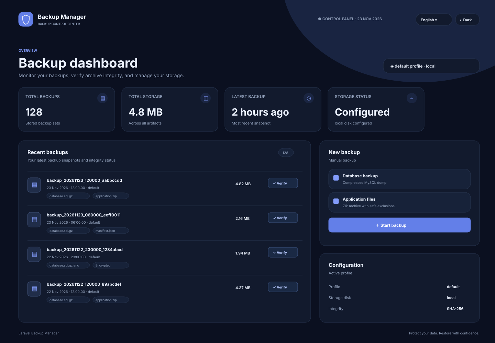
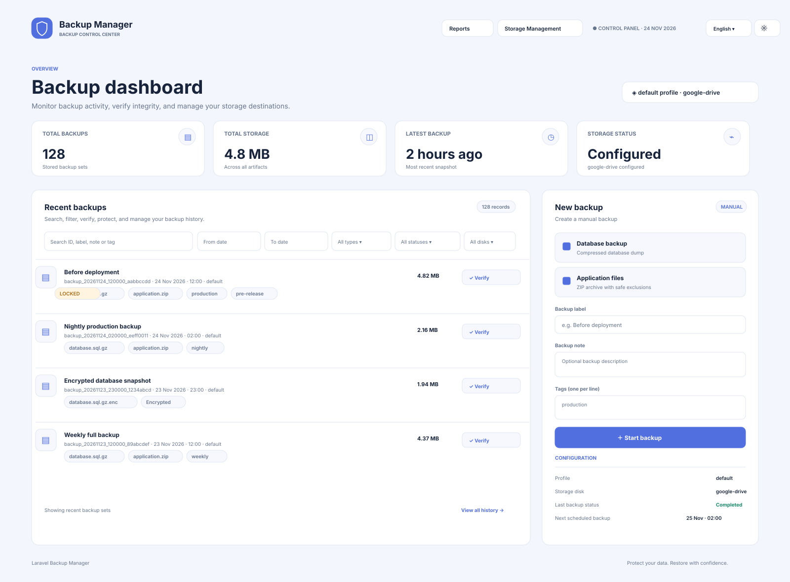

# Laravel Backup Manager

[Türkçe dokümantasyon için tıklayın](README.tr.md)

[](https://packagist.org/packages/mertaydin/laravel-backup-manager)
[](https://packagist.org/packages/mertaydin/laravel-backup-manager)
[](https://packagist.org/packages/mertaydin/laravel-backup-manager)
[](https://laravel.com)
[](https://github.com/mertaydin/laravel-backup-manager/actions/workflows/tests.yml)
[](LICENSE)

A Laravel package for database and application file backups, compression, encryption, integrity verification, restoration, and remote storage.

## Dashboard previews

**Dark theme**



**Light theme**



## Features

- Streaming MySQL backups as compressed `database.sql.gz`.
- Optional application ZIP archives with conservative default exclusions.
- Laravel Filesystem disks: local, Amazon S3 and S3-compatible services such as Cloudflare R2.
- SHA-256 checksums and JSON manifests.
- Backup history listing with `backup:list`.
- Streaming SHA-256 and file-size integrity checks with `backup:verify`.
- Verified MySQL and application ZIP restore with `backup:restore`.
- One-click integrity verification from the dashboard.
- Download individual backup artifacts and manifests directly from the dashboard.
- Delete backup sets from both the configured remote disk and the local mirror.
- Mirror each backup to a configurable local filesystem disk when remote storage is used.
- Background dashboard backups with job status polling; use a Laravel queue worker for fully independent execution.
- Configurable retention policy with safe dry-run pruning.
- Built-in responsive administration dashboard with six languages (English, Turkish, Spanish, Simplified Chinese, Hindi, and Arabic).
- Light, dark, and system theme preferences, remembered in the browser.
- Manual backup execution from Artisan or the dashboard.
- Temporary workspace cleanup and best-effort cleanup of partial uploads.

## Requirements

- PHP 8.2+
- Laravel 11, 12 or 13
- MySQL client tools (`mysqldump` and `mysql`)
- PHP `zip` extension when application file backups are enabled
- PHP `sodium` extension when backup encryption is enabled

## Installation

```bash
composer require mertaydin/laravel-backup-manager:^0.6
php artisan vendor:publish --tag=backup-manager-config
php artisan vendor:publish --tag=backup-manager-assets
```

The dashboard assets are published to `public/vendor/backup-manager`; republish them after package updates with `php artisan vendor:publish --tag=backup-manager-assets --force`. CSS and JavaScript URLs include the configurable `backup-manager.ui.asset_version` query parameter (default `0.6.1`) to prevent stale browser caches. You can override it with `BACKUP_MANAGER_ASSET_VERSION`. The dashboard is available at `/backup-manager`. It supports English, Turkish, Spanish, Simplified Chinese, Hindi, and Arabic. Users can switch between light, dark, and system themes; the selected language is saved in the session and the theme preference is saved in the browser. It uses Laravel's `web` and `auth` middleware by default. Configure access in `config/backup-manager.php`:

```php
'ui' => [
    'enabled' => true,
    'prefix' => 'backup-manager',
    'middleware' => ['web', 'auth'],
],
```

For applications with a custom admin authorization middleware, replace the middleware list with your own middleware, for example `['web', 'auth', 'can:manage-backups']`. Do not expose the dashboard publicly.

You can also register a request-based authorization callback using the package facade. This callback is an additional authorization layer; the configured route middleware (including `auth`) still runs first. If no callback is registered, the existing middleware-only behavior is preserved.

```php
use Illuminate\Http\Request;
use MertAydin\LaravelBackupManager\Facades\BackupManager;

BackupManager::auth(function (Request $request) {
    return $request->user()?->isSuperAdmin()
        && (int) $request->user()->id === 1;
});
```

Register the callback in your application's `AppServiceProvider::boot()` method or another provider that boots before the dashboard request. Return `true` to allow access and `false` to respond with HTTP 403.

## Usage

```bash
php artisan backup:run
php artisan backup:run --database
php artisan backup:run --files
php artisan backup:run --profile=default --disk=s3
php artisan backup:list
php artisan backup:list --disk=s3 --limit=50
php artisan backup:verify 20261123_120000_aabbccdd
php artisan backup:decrypt 20261123_120000_aabbccdd database.sql.gz.enc
php artisan backup:prune
php artisan backup:prune --execute
php artisan backup:restore 20261123_120000_aabbccdd --database
php artisan backup:restore 20261123_120000_aabbccdd --database --force
php artisan backup:restore 20261123_120000_aabbccdd --files --target=/var/www/my-app
php artisan backup:restore 20261123_120000_aabbccdd --files --target=/var/www/my-app --force
```

The default profile backs up the configured MySQL connection. Application files are disabled by default. When the configured backup disk is remote, each completed backup is also mirrored to `storage.local_disk` (default: `local`). Configure both destinations in `config/backup-manager.php`:

```php
'files' => [
    'enabled' => true,
    'paths' => [], // Empty means the application root.
    'exclude' => ['vendor', 'node_modules', 'storage/logs', '.git'],
    'include_dotfiles' => false,
    'exclude_env' => true,
],
```

For example, set `storage.disk` to `s3` and `storage.local_disk` to `local` to keep a local copy and upload the same backup set to S3/R2. Set both to `local` to avoid duplicate writes. Deleting a backup from the dashboard and running retention pruning remove its directory from both disks.

The dashboard returns immediately after scheduling a backup. By default, when `BACKUP_MANAGER_QUEUE_CONNECTION` is not set, Laravel runs the job after sending the HTTP response; this does not require a queue worker, but it still uses a PHP-FPM worker while the backup finishes. For long-running production backups, configure a real queue connection and run a worker:

```dotenv
BACKUP_MANAGER_QUEUE_CONNECTION=database
BACKUP_MANAGER_QUEUE=backups
```

Ensure the Laravel queue migration is installed and run `php artisan queue:work --queue=backups`. The dashboard polls the job status and refreshes when the backup completes.

The database connection is read from Laravel's `database.connections` configuration. The package uses a temporary mode-0600 MySQL option file for credentials; passwords are not passed in process arguments.

### Authenticated backup encryption

Encryption is optional and disabled by default. When enabled, each backup artifact is encrypted locally before it is uploaded. The package uses libsodium XChaCha20-Poly1305 secretstream with authenticated chunks, so large files are processed without loading them fully into memory.

Generate a 32-byte key and store the base64 output in your environment or secret manager (never commit it to source control):

```bash
php -r "echo base64_encode(random_bytes(32)), PHP_EOL;"
```

Configure the profile:

```php
'encryption' => [
    'enabled' => true,
    'key' => env('BACKUP_MANAGER_ENCRYPTION_KEY'),
    'key_id' => env('BACKUP_MANAGER_ENCRYPTION_KEY_ID'),
],
```

Encrypted artifacts receive the `.enc` suffix. The manifest records the algorithm and key identifier, but never the key itself. Keep the encryption key safe and available for the lifetime of the backups. To download, verify and decrypt an artifact:

```bash
php artisan backup:verify 20261123_120000_aabbccdd
php artisan backup:decrypt 20261123_120000_aabbccdd database.sql.gz.enc
```

By default, decrypted artifacts are written under `storage/app/backup-manager/decrypted/{backup-id}` with restrictive file permissions. Use `--output=/absolute/path` to choose another destination and `--force` only when intentionally replacing an existing file.

### Retention policy

Retention is disabled by default. Enable it in the selected profile:

```php
'retention' => [
    'enabled' => true,
    'keep_days' => 30,
    'keep_last' => 10,
],
```

The pruning command is a dry run unless `--execute` is supplied. It preserves backups inside the configured age window and always protects the newest `keep_last` valid backups. Invalid manifests are skipped and never deleted. After reviewing the preview, schedule the destructive form from your Laravel application's scheduler:

```php
Schedule::command('backup:prune --execute')->daily();
```

### Restore

The restore command always verifies the complete backup set against its manifest before proceeding. It is a dry run unless `--force` is supplied:

```bash
# Verify and preview only
php artisan backup:restore 20261123_120000_aabbccdd --database

# Restore into the database connection selected by the backup profile
php artisan backup:restore 20261123_120000_aabbccdd --database --force

# Preview or restore application files into an explicit target directory
php artisan backup:restore 20261123_120000_aabbccdd --files --target=/var/www/my-app
php artisan backup:restore 20261123_120000_aabbccdd --files --target=/var/www/my-app --force
```

Select exactly one component per command. Database restore streams the decompressed SQL into the configured `mysql` client and validates the gzip stream before executing SQL. File restore rejects path traversal, symbolic links, duplicate paths and environment files, and refuses to extract through symbolic links already present in the target. Existing files are overwritten only when `--force` is explicitly supplied. Restore is not transactional: keep a separate current backup and test restores in a staging environment before production use.

## Storage support

Local, Amazon S3, and Cloudflare R2 can be configured as Laravel filesystem disks. A dedicated Google Drive OAuth adapter is not included yet.

## Current limitations

A dedicated Google Drive OAuth adapter is not included yet. Google Drive integrations must be provided through a Laravel filesystem disk.

## Security

The dashboard is protected by `web` and `auth` middleware by default. Use an additional authorization middleware in production. Application archives exclude `.env` and hidden files by default and skip symlinks. Database output is streamed and credentials are kept out of process arguments.

## Development

Install the development dependencies and run the quality checks:

```bash
composer install
composer format
composer format:test
composer test
composer audit
```

Generate IDE autocomplete metadata with Barryvdh Laravel IDE Helper:

```bash
composer ide-helper:generate
composer ide-helper:meta
```

Generated IDE Helper files are excluded from version control.

## License

MIT
