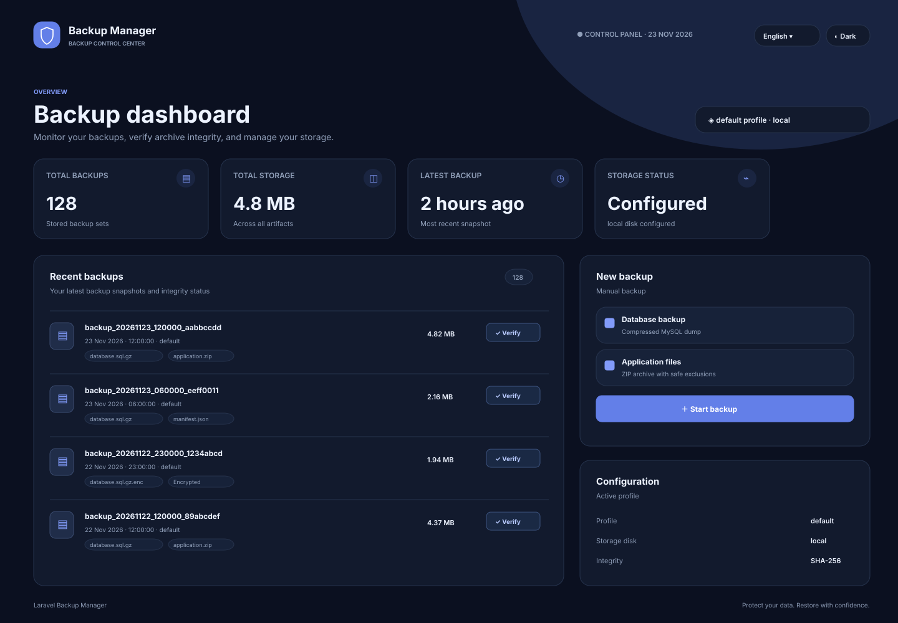
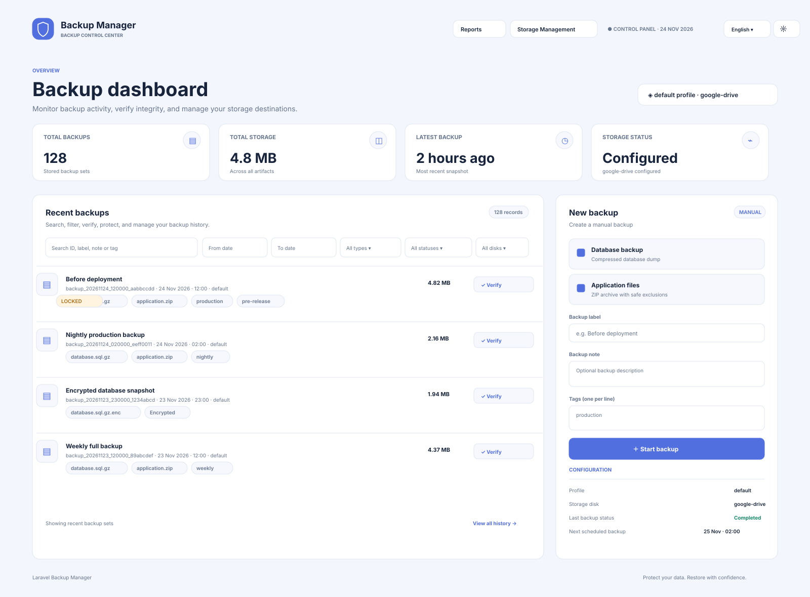

# Laravel Backup Manager

[English documentation](README.md)

[](https://packagist.org/packages/mertaydin/laravel-backup-manager)
[](https://packagist.org/packages/mertaydin/laravel-backup-manager)
[](https://packagist.org/packages/mertaydin/laravel-backup-manager)
[](https://laravel.com)
[](https://github.com/mertaydin/laravel-backup-manager/actions/workflows/tests.yml)
[](LICENSE)

Laravel uygulamaları için MySQL veritabanı ve uygulama dosyası yedekleme, sıkıştırma, şifreleme, bütünlük doğrulama, geri yükleme ve uzak depolama paketi.

## Panel önizlemeleri

**Koyu tema**



**Açık tema**



## Özellikler

- MySQL ve PostgreSQL veritabanlarını sıkıştırılmış SQL arşivlerine, SQLite veritabanlarını tutarlı sıkıştırılmış snapshot dosyalarına yedekleme.
- İsteğe bağlı uygulama dosyalarını ZIP arşivine alma.
- Laravel Filesystem diskleri: local, Amazon S3 ve Cloudflare R2 gibi S3 uyumlu servisler.
- SHA-256 checksum, JSON manifest ve GZIP/ZIP arşiv yapısı doğrulaması.
- Artisan komutlarıyla yedek listeleme, doğrulama, şifre çözme ve geri yükleme.
- Yönetim panelinden yedek başlatma, durumunu takip etme ve dosyaları indirme.
- Yedek silindiğinde hem uzak depodan hem yerel kopyadan kaldırma.
- Uzak depoya gönderilen yedekleri ayrıca yerel diske kopyalama.
- Kuyruk bağlantısı tanımlandığında gerçek Laravel queue job kullanma.
- Saklama politikası ve güvenli önizleme (dry-run) ile eski yedekleri temizleme.
- Türkçe, İngilizce, İspanyolca, Basitleştirilmiş Çince, Hintçe ve Arapça panel.
- Açık, koyu ve sistem teması.
- Geçici dosyaları işlem sonunda temizleme ve başarısız yüklemelerde kısmi dosyaları silmeye çalışma.
- Depolama bağlantısı, listeleme, yazma, okuma ve silme izinleri için Storage Health Check.
- MySQL araçları, PHP eklentileri, geçici dizin izinleri ve depolama erişimi için yedekleme öncesi kontroller.
- Yedek etiketi, açıklaması, etiketleri ve yapılandırılabilir otomatik isimlendirme şablonu.
- Tarih, tür, depolama diski ve manifest durumuna göre yedek geçmişi filtreleme.
- Dosya boyutları ve SHA-256 checksum değerleriyle ayrıntılı yedek inceleme ekranı.
- Yükleme sonrası otomatik bütünlük doğrulaması (yapılandırılabilir).
- `BackupCompleted`, `BackupFailed`, `BackupDeleted` ve `BackupRestored` Laravel event'leri.
- Panelde sonraki otomatik yedekleme zamanı ve toplam yedek depolama kullanımı.
- Geri döndürülemez geri yükleme işlemleri öncesinde açık onay.

## Gereksinimler

- PHP 8.2+
- Laravel 11, 12 veya 13
- MySQL bağlantıları için istemci araçları (`mysqldump` ve `mysql`)
- PostgreSQL bağlantıları için istemci araçları (`pg_dump` ve `psql`)
- SQLite bağlantıları için PHP `pdo_sqlite` eklentisi ve dosya tabanlı veritabanı
- Uygulama dosyalarını yedeklemek için PHP `zip` eklentisi
- Yedek şifreleme etkinleştirilecekse PHP `sodium` eklentisi

## Kurulum

```bash
composer require mertaydin/laravel-backup-manager:^0.8
php artisan vendor:publish --tag=backup-manager-config
php artisan vendor:publish --tag=backup-manager-assets
```

Panel varsayılan olarak `/backup-manager` adresinde açılır. Asset dosyaları `public/vendor/backup-manager` konumuna yayınlanır. CSS ve JavaScript adresleri tarayıcı önbelleğini yenilemek için `backup-manager.ui.asset_version` parametresini kullanır (varsayılan `0.8.2`). `BACKUP_MANAGER_ASSET_VERSION` ortam değişkeniyle değiştirilebilir. Paket güncellendiğinde:

```bash
php artisan vendor:publish --tag=backup-manager-assets --force
php artisan optimize:clear
```

Varsayılan panel middleware ayarı:

```php
'ui' => [
    'enabled' => true,
    'prefix' => 'backup-manager',
    'middleware' => ['web', 'auth'],
],
```

Panel erişimini ayrıca bir yetkilendirme callback'i ile sınırlandırabilirsiniz. Bu callback, yapılandırılmış middleware katmanına ek olarak çalışır; `auth` middleware'ini devre dışı bırakmaz.

```php
use Illuminate\Http\Request;
use MertAydin\LaravelBackupManager\Facades\BackupManager;

BackupManager::auth(function (Request $request) {
    return $request->user()?->isSuperAdmin()
        && (int) $request->user()->id === 1;
});
```

Bu tanımı uygulamanızın `AppServiceProvider::boot()` metoduna ekleyebilirsiniz. Callback `true` döndürürse erişim verilir; `false` döndürürse HTTP 403 yanıtı verilir. Callback tanımlanmadığında mevcut middleware tabanlı davranış korunur. Paneli herkese açık bırakmayın.

## Veritabanı migration işlemi

**Paketi kurduktan veya v0.6.3 sürümüne yükselttikten sonra migration komutunu mutlaka çalıştırın:**

```bash
php artisan migrate
```

Paket migration dosyalarını Service Provider üzerinden otomatik olarak Laravel'e tanıtır. Migration dosyasını ayrıca publish etmeniz gerekmez. Bu komut, Storage Management ekranının şifrelenmiş depolama bilgilerini ve otomatik yedekleme ayarlarını saklamak için kullandığı `backup_manager_storage_settings` tablosunu oluşturur. Bu tablo oluşturulmadıysa panelde MySQL `1146` (`Table doesn't exist`) hatası alırsınız.

Migration'ın çalışıp çalışmadığını kontrol etmek için:

```bash
php artisan migrate:status
```

Migration beklemede görünüyorsa uygulamanın kullandığı aynı ortam ve veritabanı bağlantısıyla `php artisan migrate` komutunu çalıştırın. Production ortamında migration öncesinde veritabanı yedeği alın.

## Kullanım

```bash
php artisan backup:run
php artisan backup:run --database
php artisan backup:run --files
php artisan backup:run --profile=default --disk=s3
php artisan backup:list
php artisan backup:list --disk=s3 --limit=50
php artisan backup:verify 20261123_120000_aabbccdd
php artisan backup:compare 20261123_120000_aabbccdd 20261124_120000_ccddeeff
php artisan backup:report --json
php artisan backup:protect 20261123_120000_aabbccdd --reason="Mevzuat saklama"
php artisan backup:protect 20261123_120000_aabbccdd --until="2027-01-01T00:00:00Z"
php artisan backup:protect 20261123_120000_aabbccdd --unlock
php artisan backup:decrypt 20261123_120000_aabbccdd database.sql.gz.enc
php artisan backup:prune
php artisan backup:prune --execute
php artisan backup:restore 20261123_120000_aabbccdd --database
php artisan backup:restore 20261123_120000_aabbccdd --database --force
php artisan backup:restore 20261123_120000_aabbccdd --files --target=/var/www/my-app
php artisan backup:restore 20261123_120000_aabbccdd --files --target=/var/www/my-app --force
```

Varsayılan profil Laravel yapılandırmasındaki MySQL bağlantısını kullanır. Uygulama dosyası yedeklemesi varsayılan olarak kapalıdır. Örnek dosya ayarları:

```php
'files' => [
    'enabled' => true,
    'paths' => [], // Boş bırakılırsa uygulama kök dizini.
    'exclude' => ['vendor', 'node_modules', 'storage/logs', '.git'],
    'include_dotfiles' => false,
    'exclude_env' => true,
],
```

### Yerel ve uzak depolama

Yedekler `storage.disk` üzerinde saklanır; ayrıca `storage.local_disk` (varsayılan: `local`) üzerine kopyalanır. Örneğin `disk=s3` ve `local_disk=local` ayarları aynı yedek setini S3/R2'ye yükler ve yerelde de tutar. İki disk aynıysa yinelenen yazma yapılmaz. Panelden silme ve retention temizliği her iki diskteki yedek dizinini de kaldırır.

### Arka plan yedekleme ve kuyruk

Panel yedekleme isteğinden sonra HTTP yanıtını bekletmeden döner. Kuyruk bağlantısı belirtilmemişse iş Laravel'in `afterResponse` mekanizmasıyla yanıt gönderildikten sonra çalışır. Bu yöntem kuyruk worker gerektirmez ancak işlem bitene kadar bir PHP-FPM worker kullanmaya devam eder. Uzun süren üretim yedeklemelerinde gerçek bir kuyruk kullanın:

```dotenv
BACKUP_MANAGER_QUEUE_CONNECTION=database
BACKUP_MANAGER_QUEUE=backups
```

Laravel queue migration'larının kurulu olduğundan emin olun ve worker'ı başlatın:

```bash
php artisan queue:work --queue=backups
```

Panel iş durumunu sorgular ve yedek tamamlandığında listeyi yeniler.

### Şifreleme

Şifreleme isteğe bağlıdır ve varsayılan olarak kapalıdır. Etkinleştirildiğinde her dosya yüklenmeden önce XChaCha20-Poly1305 secretstream ile parçalı ve doğrulanabilir biçimde şifrelenir.

32 baytlık anahtar üretin:

```bash
php -r "echo base64_encode(random_bytes(32)), PHP_EOL;"
```

Anahtarı kaynak koduna eklemeyin; ortam değişkeni veya secret manager kullanın:

```php
'encryption' => [
    'enabled' => true,
    'key' => env('BACKUP_MANAGER_ENCRYPTION_KEY'),
    'key_id' => env('BACKUP_MANAGER_ENCRYPTION_KEY_ID'),
],
```

Manifest algoritma ve anahtar kimliğini tutar; anahtarın kendisini içermez. Anahtarı yedeklerin saklama süresi boyunca güvenli biçimde muhafaza edin.

### Saklama politikası

Saklama politikası varsayılan olarak kapalıdır. Etkinleştirmek için:

```php
'retention' => [
    'enabled' => true,
    'keep_days' => 30,
    'keep_last' => 10,
],
```

`backup:prune` komutu `--execute` verilmedikçe yalnızca silinecek adayları listeler. Geçersiz manifest içeren yedekler silinmez. Önizlemeyi kontrol ettikten sonra Laravel Scheduler üzerinden çalıştırabilirsiniz:

```php
Schedule::command('backup:prune --execute')->daily();
```

### Panelden otomatik yedekleme

Panelde **Backup Manager → Storage Management → Automatic backups** bölümünden otomatik yedeklemeyi açıp kapatabilirsiniz. Günlük çalışma saatini, saat dilimini ve kaç günden eski yedeklerin silineceğini belirleyebilirsiniz. Eski yedeklerin temizliği yalnızca zamanlanmış yedek başarıyla tamamlandıktan sonra çalışır ve belirlenen günden eski yedek setlerini kalıcı olarak siler.

Sunucuda Laravel Scheduler her dakika çalıştırılmalıdır. Crontab'a bir kez aşağıdaki satırı ekleyin:

```cron
* * * * * cd /uygulama/dizini && php artisan schedule:run >> /dev/null 2>&1
```

Panelden otomatik yedeklemeyi pasife almak zamanlanmış çalışmaları durdurur; manuel yedekleme kullanılmaya devam eder. Varsayılan olarak otomatik yedekleme kapalıdır.

### Geri yükleme

Geri yükleme öncesinde yedek setinin tamamı manifest üzerinden doğrulanır. `--force` kullanılmadığında komut yalnızca önizleme yapar. Veritabanı geri yüklemesi sıkıştırılmış SQL'i akış halinde MySQL istemcisine aktarır. Dosya geri yüklemesi path traversal, sembolik bağlantılar, yinelenen yollar ve `.env` dosyalarına karşı kontroller uygular. Var olan dosyalar yalnızca `--force` ile üzerine yazılır.

Geri yükleme işlemi transaction tabanlı değildir. Üretimde kullanmadan önce mevcut sistemin ayrı bir yedeğini alın ve geri yüklemeyi staging ortamında test edin.

## Yedek metaverisi, isimlendirme ve event'ler

Panelden oluşturulan yedeklere okunabilir bir ad, açıklama ve en fazla on etiket ekleyebilirsiniz. Bu bilgiler yedek manifest dosyasında saklanır ve paneldeki yedek geçmişinde aranabilir.

Özel bir ad girilmezse `BACKUP_MANAGER_NAME_TEMPLATE` kullanılarak otomatik ad oluşturulur. Varsayılan şablon `:app-:date-:time` şeklindedir. Desteklenen değişkenler:

- `:app` — Laravel uygulama adının slug biçimi.
- `:date` — `YYYYMMDD` biçiminde tarih.
- `:time` — `HHMMSS` biçiminde saat.
- `:id` — tam yedek kimliği.

Paket yedekleme yaşam döngüsünde aşağıdaki Laravel event'lerini tetikler:

- `MertAydin\LaravelBackupManager\Events\BackupCompleted`
- `MertAydin\LaravelBackupManager\Events\BackupFailed`
- `MertAydin\LaravelBackupManager\Events\BackupDeleted`
- `MertAydin\LaravelBackupManager\Events\BackupRestored`

Laravel'in standart event/listener kayıt yöntemlerini kullanabilirsiniz. Tamamlanma ve hata event'lerinde sonuç `$event->result` üzerinden; silme ve geri yükleme event'lerinde `backupId` üzerinden alınabilir. `BackupRestored` ayrıca geri yüklenen bileşeni taşır.

## Depolama sağlığı ve yedekleme öncesi kontroller

**Storage Management → Laravel Filesystem disks → Test connection and permissions** üzerinden disk bağlantısını test edebilirsiniz. Kontrol, yapılandırılmış yedekleme dizini altında geçici bir dosya oluşturur; listeleme, yazma, okuma ve silme işlemlerini dener ve test dosyasını işlem sonunda temizler.

Panelden yedekleme kuyruğa alınmadan önce geçici çalışma dizini, depolama diskleri, MySQL bağlantı türü ve `mysqldump` komutu kontrol edilir. Seçilen özelliklere göre PHP ZIP ve sodium eklentileri de doğrulanır.

## Otomatik bütünlük doğrulaması

Yedek dosyaları depolamaya yüklendikten sonra SHA-256 checksum ve dosya boyutları varsayılan olarak yeniden doğrulanır. Gerekirse bu ek okuma işlemini kapatabilirsiniz:

```dotenv
BACKUP_MANAGER_VERIFY_AFTER_UPLOAD=false
```

## Depolama desteği

Laravel Filesystem diskleri üzerinden local, Amazon S3 ve Cloudflare R2 kullanılabilir. Pakette yerleşik Google Drive OAuth adaptörü henüz bulunmuyor; Google Drive bağlantısı Laravel Filesystem diski olarak ayrıca sağlanmalıdır.

## Güvenlik notları

- Panel varsayılan olarak `web` ve `auth` middleware'leriyle korunur; ayrıca callback ile yönetici yetkisi kontrolü ekleyin.
- Veritabanı parolası komut satırı argümanlarına yazılmaz; geçici ve kısıtlı izinli MySQL option dosyası kullanılır.
- Uygulama arşivlerinde `.env` ve gizli dosyalar varsayılan olarak dışarıda bırakılır; sembolik bağlantılar arşive alınmaz.
- Şifreleme anahtarını repository'ye veya yedek manifestine koymayın.
- Yedekleri indirme ve geri yükleme yetkisini yalnızca güvenilir yöneticilere verin.
- Geri yükleme işlemlerini önce staging ortamında doğrulayın.

## Geliştirme

Geliştirme bağımlılıklarını kurup kalite kontrollerini çalıştırın:

```bash
composer install
composer format
composer format:test
composer test
composer audit
```

Barryvdh Laravel IDE Helper ile IDE otomatik tamamlama dosyalarını üretin:

```bash
composer ide-helper:generate
composer ide-helper:meta
```

Üretilen IDE Helper dosyaları Git sürüm kontrolüne dahil edilmez.

## Lisans

MIT


## Yedek koruması, tekrar deneme, çoklu hedef ve raporlama

Yedek oluşturulurken manifest'e koruma bilgisi ekleyerek manuel silme ve retention temizliğini engelleyebilirsiniz:

```php
app(\MertAydin\LaravelBackupManager\BackupManager::class)->run([
    'locked' => true,
    'protection_reason' => 'Aylık mevzuat yedeği',
]);
```

Süreli koruma için ISO-8601 tarih/saat biçiminde `protected_until` verilebilir. Manuel silme ve retention temizliği bu korumaya uyar.

Başarısız yedeklemeler için tekrar deneme sayısı ve bekleme süresi:

```dotenv
BACKUP_MANAGER_RETRY_ATTEMPTS=3
BACKUP_MANAGER_RETRY_DELAY=30
```

Aynı yedek setini birden fazla Laravel Filesystem diskine göndermek için:

```dotenv
BACKUP_MANAGER_TARGET_DISKS=s3,r2
```

Birincil disk ve yerel ayna hedefleri korunur; yinelenen disk adları tekilleştirilir. Bütün hedefler yedekleme öncesi ve yükleme sonrası bütünlük kontrollerinden geçirilir. Flysystem AWS S3 adaptörü ve AWS SDK multipart uploader kuruluysa 64 MiB üzerindeki dosyalar varsayılan olarak 8 MiB parçalarla yüklenir.

E-posta ve Slack bildirimleri isteğe bağlıdır:

```dotenv
BACKUP_MANAGER_NOTIFICATIONS_ENABLED=true
BACKUP_MANAGER_NOTIFICATION_EMAILS=ops@example.com,admin@example.com
BACKUP_MANAGER_SLACK_WEBHOOK=https://hooks.slack.com/services/REDACTED
```

Slack webhook adresini secret manager veya ortam değişkeninde saklayın; kaynak koduna eklemeyin. Tamamlanan ve başarısız olan yedeklemeler için bildirim gönderilir.

MySQL için tablo dahil etme/dışlama filtreleri desteklenir. PostgreSQL ve SQLite yedeklemesi seçilen veritabanının tamamını kapsar. SQLite `:memory:` bağlantıları kalıcı veritabanı dosyası olmadığı için desteklenmez.

Bir yedeği kalıcı olarak veya belirli bir tarihe kadar korumaya alabilirsiniz. Korunan yedekler manuel silme ve retention temizliği tarafından silinmez:

```bash
php artisan backup:protect YEDEK_ID --reason="Mevzuat saklama"
php artisan backup:protect YEDEK_ID --until="2027-01-01T00:00:00Z"
php artisan backup:protect YEDEK_ID --unlock
```

İki yedeğin manifest ve dosya boyutlarını karşılaştırın:

```bash
php artisan backup:compare YEDEK_ID_1 YEDEK_ID_2 --disk=s3
```

Yedek envanteri ve toplam depolama kullanım raporu:

```bash
php artisan backup:report --json
```
